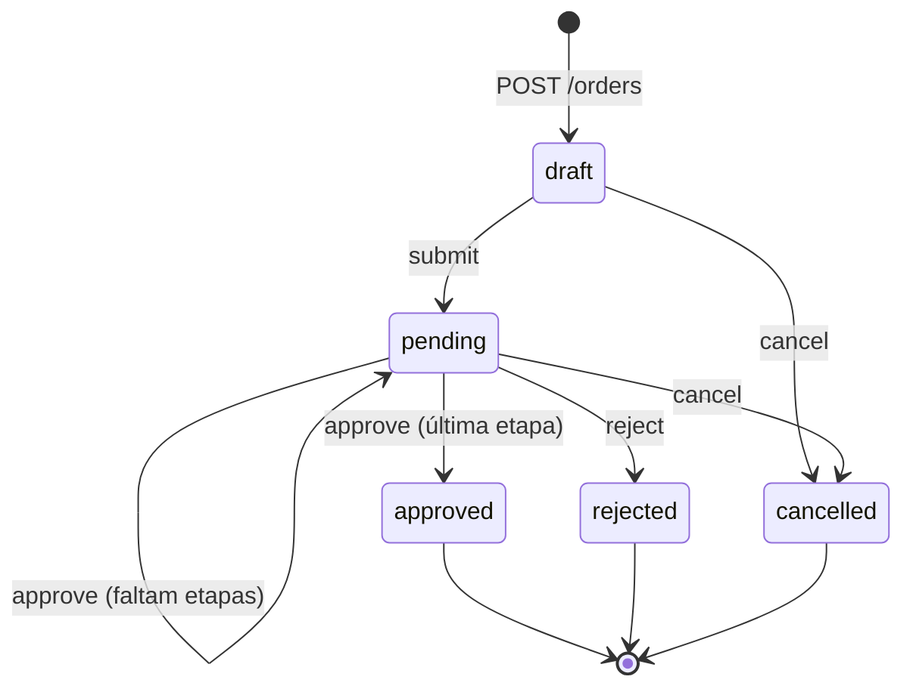

# Aprova API

[](https://github.com/RyanProgrwm/aprova-api/actions/workflows/ci.yml)


API REST de **pedidos de compra com fluxo de aprovação em níveis**, no estilo dos ERPs: quanto maior o valor do pedido, mais níveis de alçada precisam aprová-lo, sempre em sequência e com histórico completo de quem fez o quê.

Escolhi esse domínio porque trabalho com ERP no dia a dia (Oracle PL/SQL) e vejo de perto o que um fluxo de aprovação precisa garantir: alçada por valor, segregação de funções e trilha de auditoria.

## Funcionalidades

- **Autenticação JWT** com três perfis: solicitante, aprovador (níveis 1 a 3) e administrador
- **Alçada por faixa de valor**: o pedido define sozinho quantos níveis precisa
- **Aprovação sequencial**: a etapa 2 só abre depois da etapa 1, e cada etapa exige aprovador do nível certo
- **Segregação de funções**: quem pede não aprova, e o mesmo aprovador não decide duas etapas
- **Fila do aprovador**: `GET /orders/awaiting-my-approval` traz só o que ele pode decidir agora
- **Histórico de auditoria** de cada pedido (criação, envio, cada etapa, reprovação, cancelamento)
- **Reprovação com motivo obrigatório**
- Listagem com **filtro e paginação**
- **Documentação interativa** (Swagger) em `/docs`
- **33 testes automatizados** (unitários e de integração) rodando no **GitHub Actions** em Node 22 e 24
- **Docker** com usuário sem privilégio de root

## Regras de alçada

| Valor do pedido                | Níveis exigidos |
| ------------------------------ | --------------- |
| até R$ 5.000,00                | 1               |
| até R$ 50.000,00               | 2               |
| acima de R$ 50.000,00          | 3               |

Um aprovador de nível *N* pode decidir qualquer etapa até a *N*. As faixas ficam em [`approval-rules.js`](src/modules/orders/approval-rules.js).

## Ciclo de vida do pedido



## Stack

- **Node.js** com ES Modules e **Express 5**
- **SQLite nativo do Node** (`node:sqlite`): nenhuma dependência compilada e nenhum banco para instalar
- **Zod** para validação, com mensagens em português
- **JWT** + **bcrypt** para autenticação
- **Helmet** para cabeçalhos de segurança
- **node:test** + **Supertest** para os testes

## Como rodar

Pré-requisito: Node.js 22.13 ou superior.

```bash
git clone https://github.com/RyanProgrwm/aprova-api.git
cd aprova-api
npm install
npm run seed   # cria usuários e pedidos de exemplo
npm run dev    # sobe em http://localhost:3000 com reload automático
```

Depois, abra **http://localhost:3000/docs** para testar pelo navegador.

O seed cria estes usuários, todos com a senha `senha12345`:

| E-mail             | Perfil                 |
| ------------------ | ---------------------- |
| admin@aprova.dev   | administrador          |
| ana@aprova.dev     | solicitante            |
| bruno@aprova.dev   | aprovador nível 1      |
| carla@aprova.dev   | aprovador nível 2      |
| diego@aprova.dev   | aprovador nível 3      |

### Com Docker

```bash
docker build -t aprova-api .
docker run -p 3000:3000 -e JWT_SECRET=um-segredo-longo aprova-api
```

## Exemplo de uso

```bash
# login como solicitante
TOKEN=$(curl -s -X POST localhost:3000/auth/login \
  -H "Content-Type: application/json" \
  -d '{"email":"ana@aprova.dev","password":"senha12345"}' | jq -r .token)

# cria um pedido de R$ 9.000,00 (exige 2 níveis)
curl -X POST localhost:3000/orders \
  -H "Authorization: Bearer $TOKEN" -H "Content-Type: application/json" \
  -d '{"supplier":"Tech Distribuidora","items":[{"description":"notebook","quantity":2,"unitPriceCents":450000}]}'

# envia para aprovação
curl -X POST localhost:3000/orders/3/submit -H "Authorization: Bearer $TOKEN"
```

## Endpoints

| Método | Rota                            | Quem usa      | Descrição                                   |
| ------ | ------------------------------- | ------------- | ------------------------------------------- |
| POST   | `/auth/login`                   | todos         | devolve o token JWT                         |
| GET    | `/users/me`                     | todos         | dados do usuário logado                     |
| GET    | `/users`                        | admin         | lista usuários                              |
| POST   | `/users`                        | admin         | cadastra usuário                            |
| GET    | `/orders`                       | todos         | lista pedidos (solicitante vê só os seus)   |
| POST   | `/orders`                       | todos         | cria pedido em rascunho                     |
| GET    | `/orders/awaiting-my-approval`  | aprovador     | fila de pedidos que ele pode decidir        |
| GET    | `/orders/:id`                   | todos         | detalhe com itens, aprovações e histórico   |
| POST   | `/orders/:id/submit`            | solicitante   | envia o rascunho para aprovação             |
| POST   | `/orders/:id/cancel`            | solicitante   | cancela rascunho ou pedido pendente         |
| POST   | `/orders/:id/approve`           | aprovador     | aprova a próxima etapa                      |
| POST   | `/orders/:id/reject`            | aprovador     | reprova com motivo                          |

## Testes

```bash
npm test
```

Cobrem as regras de alçada isoladas e o fluxo completo pela API: aprovação em vários níveis, aprovador sem alçada, segregação de funções, reprovação, cancelamento, visibilidade entre solicitantes, validação, paginação e autenticação. Cada suíte usa um banco em memória próprio, então os testes não dependem de nada externo.

## Decisões técnicas

- **Dinheiro em centavos (inteiro).** `0.1 + 0.2` não dá `0.3` em ponto flutuante; com inteiros, a soma do pedido é sempre exata. A API recebe e devolve `unitPriceCents` e `totalCents`.
- **Transações explícitas.** Gravar a aprovação, mudar o status e registrar o histórico acontecem juntos ou não acontecem.
- **404 em vez de 403 para pedido alheio.** O solicitante não descobre que um pedido de outra pessoa existe.
- **Usuário relido a cada requisição.** Se o administrador muda o nível de um aprovador, vale na hora, sem esperar o token expirar.
- **Regras de negócio separadas das rotas.** [`approval-rules.js`](src/modules/orders/approval-rules.js) é uma função pura, testada sem HTTP e sem banco.
- **Restrições também no banco.** `check` e `unique` no schema impedem estados inválidos mesmo se alguém gravar direto no SQLite.

## Estrutura

```
src/
├── app.js                 # monta o express (middlewares, rotas, erros)
├── server.js              # sobe o servidor
├── config.js              # variáveis de ambiente
├── db.js                  # schema do sqlite e helper de transação
├── errors.js              # AppError e tratamento centralizado de erros
├── docs/openapi.js        # especificação do swagger
├── middlewares/auth.js    # autenticação jwt e autorização por perfil
└── modules/
    ├── auth/              # login
    ├── users/             # cadastro de usuários
    └── orders/            # pedidos, regras de alçada e fluxo de aprovação
test/                      # testes unitários e de integração
scripts/seed.js            # dados de exemplo
```

## Próximos passos

- [ ] Deploy na AWS (App Runner ou Lambda + API Gateway)
- [ ] Trocar o SQLite por PostgreSQL com migrations
- [ ] Notificar o aprovador por e-mail quando um pedido entra na fila dele
- [ ] Faixas de alçada configuráveis por centro de custo

## Autor

**Ryan Rodrigues Saldanha Faria**: desenvolvedor Oracle PL/SQL em ERP, estudando Node.js e AWS.

[LinkedIn](https://www.linkedin.com/in/ryansaldanha1302) · [GitHub](https://github.com/RyanProgrwm)
